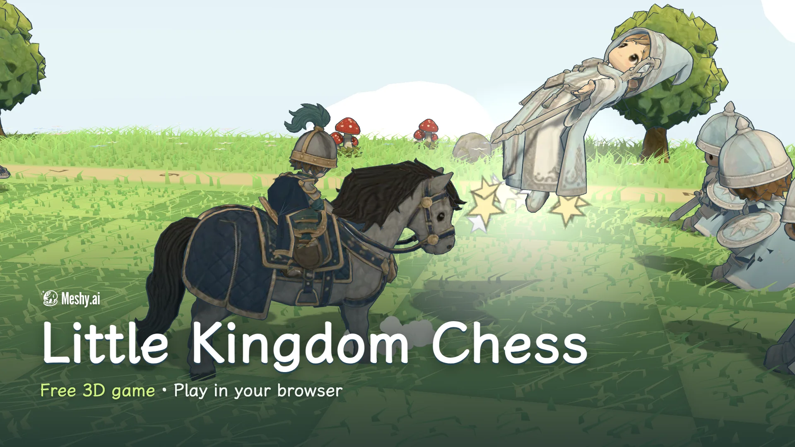

# Little Kingdom Chess

Chinese version: [README.zh-CN.md](README.zh-CN.md)



A 3D chess game for the browser, played on a lawn on a floating meadow island. Every piece is a hand-painted storybook character that acts out its moves: soldiers (pawns) march and slash with their swords, the knight is a little rider on a pony that gallops and leaps, the wizard (bishop) casts a spell from his staff, the queen sends a charm of hearts and stars, the king brings his sceptre down in a shockwave, and the rook is a rolling siege tower that charges. A captured piece falls over and turns into petals.

**[Play it online](https://www.meshy.ai/3d-games/little-kingdom-chess)**


## Features

- **Full chess rules**: castling, en passant, promotion (with a choice of piece), check, checkmate, stalemate, the fifty-move rule, threefold repetition and insufficient material.
- **Two modes**: against the computer (Easy, Normal, Hard; play pale blue, deep teal or random), or two players on one screen, where the camera turns to whoever moves next.
- A computer opponent that searches in a Web Worker, so the animations never stop while it thinks.
- Undo, a move list with piece portraits, captured pieces with the material lead, an optional close-up camera on captures and checks, synthesized music and sound effects.
- A game in progress is saved in the browser and resumes after a reload.
- Six languages: English, Chinese, Japanese, Portuguese, Spanish and Russian.
- Works on phones in portrait as well as on desktop.

## Running it

Requires Node.js 20.19+ (or 22.12+) and [pnpm](https://pnpm.io).

```bash
pnpm install
pnpm dev          # dev server
pnpm build        # static build in dist/
pnpm preview      # serves dist/
```

The build is a static site with relative paths, so `dist/` can be hosted from any folder. Everything it loads (models, textures, font) is in this repository; nothing comes from a CDN.

Append `?lang=zh` (or `ja`, `pt`, `es`, `ru`) to the URL to open it in another language; the menu also has a language switch, and the choice is remembered.

## Controls

Click a piece, then one of the flowers (moves) or red rings (captures). Drag to orbit the camera, scroll or pinch to zoom. `U` or Ctrl/⌘+Z undoes, `F` turns the board, `Esc` opens the menu.

## How it is built

- [three.js](https://threejs.org) 0.187 with `WebGPURenderer`. Shaders (the grass, the island, the sky) are written in TSL, the three.js shading language. Browsers without WebGPU fall back to WebGL 2 automatically; the renderer in use is shown in a corner of the screen.
- Plain JavaScript ES modules, bundled with [Vite](https://vite.dev). No framework.
- The toon look is `MeshToonNodeMaterial` with a three-step gradient map, plus `toonOutlinePass` for the ink outlines.
- The lawn is a single mesh of tens of thousands of grass blades. A vertex shader sways them in the wind and pushes them away from up to 32 pieces each frame.
- All humanoid characters share one skeleton-only clip file, since their rigs use the same bone names; `AnimationMixer` binds clips by name.
- Capture sequences are written as `async` functions over a small tween clock driven by the render loop. A reset (undo, new game) bumps a generation counter so that a sequence still playing never touches the new board.
- Effects (petals, hearts, spells, dust) are drawn procedurally, and all sound is synthesized with the Web Audio API: no image or audio files are loaded for them.

## Project layout

```
index.html, style.css   page and UI
src/
  main.js               UI, input, camera, game flow
  stage.js              move and capture choreography
  piece.js              characters: rigs, clips, held props
  world.js              island, lawn, grass shader, sky
  fx.js, audio.js       procedural effects and synthesized sound
  chess.js              rules and move generation
  ai.js, ai-worker.js   alpha-beta search, run in a Web Worker
  i18n.js, lang/        translations, keyed by the English text
public/                 models (glTF, meshopt + WebP), piece icons, font
art/                    Blender and Python scripts that made the models game-ready
sim/perft.mjs           checks the move generator against standard perft counts
tools/                  portrait renderer for the icons, translation check
media/                  images for this README
```

Two checks that need no browser:

```bash
pnpm perft        # move generation against the standard perft positions
pnpm lang-check   # every string translated in every language
```

## The models

All characters and props were generated with [Meshy](https://www.meshy.ai): concept image, one image per piece, low-poly models with smart topology, auto-rigging for the humanoids, clips from Meshy's animation library and text-to-motion for riding.

Auto-rigging only covered humanoids at the time, and its weights needed fixing in places, so `art/` holds the scripts that finished the job. They run in Blender without a window (`Blender -b --python <script> -- …`):

- `rig_horse.py` builds a quadruped skeleton for each pony, weights it, and keys six clips (idle, trot, gallop, rear, jump, die).
- `split_wheels.py` cuts the siege towers' wheels out as separate objects with their origins on the axles, so the game can roll them.
- `rigid_props.py` weights each soldier's shield and sword 100% to one hand bone so they stop bending, and can push a shield clear of the arm. It writes the new weights straight into the original GLB, without a Blender re-export, so the shared animation clips still match the rig.
- `build_anims.py` packs the animation clips into one skeleton-only GLB.
- `export_models.sh` rebuilds every file in `public/models` from the raw Meshy outputs, which are not part of this repository.

## License

The code and the models are released under the [MIT License](LICENSE).

The font is a subset of [LXGW WenKai](https://github.com/lxgw/LxgwWenKai), under the SIL Open Font License 1.1; its copyright notice is kept inside the font file. After changing any text, re-subset it from the full font so new characters are included:

```bash
python3 -m fontTools.subset LXGWWenKai-Medium.ttf --flavor=woff2 --layout-features='*' --name-IDs='*' \
  --unicodes=U+20-7E,U+A0-FF,U+2010-2027,U+2190-2193,U+FF01-FF1F \
  --text-file=<(cat src/*.js src/lang/*.js index.html) --output-file=public/fonts/lxgw-wenkai.woff2
```
