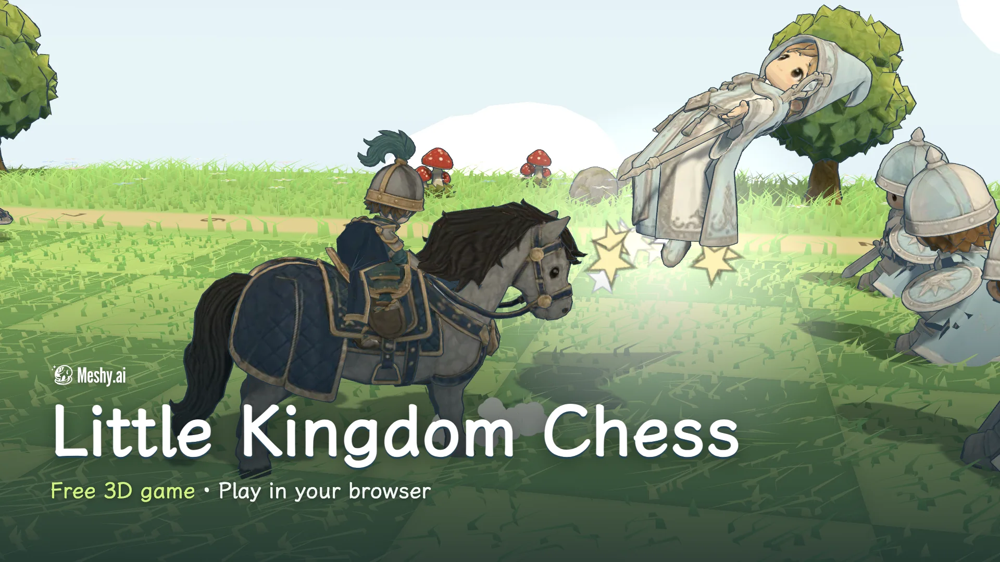

# 小小王国棋（Little Kingdom Chess）

[English](README.md)



一款在浏览器里玩的 3D 国际象棋。棋盘是一片草坪，在一座浮空的小岛上。每个棋子都是手绘绘本风格的角色，会把自己的走法演出来：兵是持剑的小兵，吃子时挥剑把对方砍倒；马是骑在小马上的骑手，会奔跑、会跳跃；象是法师，用法杖放出魔法；王后放出爱心和星星；国王用权杖砸出冲击波；车是一座会滚的攻城塔，会蓄力冲撞。被吃掉的棋子倒下，化成花瓣。

**[在线试玩](https://www.meshy.ai/3d-games/little-kingdom-chess)**


## 功能

- **完整的国际象棋规则**：王车易位、吃过路兵、升变（可以选升成什么）、将军、将死、逼和、五十步规则、三次重复局面、子力不足。
- **两种模式**：和电脑下（轻松、普通、困难三档，可以执浅蓝、深青或随机），或者两人同屏，镜头会转到该走棋的一方。
- 电脑在 Web Worker 里搜索，思考的时候动画不会卡住。
- 悔棋、带棋子头像的棋谱、被吃棋子和子力优势、吃子和将军时的镜头特写（可以关掉）、合成的音乐和音效。
- 对局会存在浏览器里，刷新后可以继续。
- 支持六种语言：英语、中文、日语、葡萄牙语、西班牙语、俄语。
- 桌面和手机竖屏都能玩。

## 运行

需要 Node.js 20.19 以上（或 22.12 以上）和 [pnpm](https://pnpm.io)。

```bash
pnpm install
pnpm dev          # 开发服务器
pnpm build        # 静态构建，输出到 dist/
pnpm preview      # 预览 dist/
```

构建产物是使用相对路径的静态网站，`dist/` 放在任何目录下都能运行。用到的所有资源（模型、贴图、字体）都在仓库里，不依赖任何 CDN。

在网址后面加 `?lang=zh`（或 `ja`、`pt`、`es`、`ru`）可以直接用对应语言打开；菜单里也有语言切换，选择会被记住。

## 操作

点一个棋子，再点小花（走到这里）或红圈（吃这个子）。拖动可以转动镜头，滚轮或双指捏合缩放。`U` 或 Ctrl/⌘+Z 悔棋，`F` 转动棋盘，`Esc` 打开菜单。

## 实现

- [three.js](https://threejs.org) 0.187，使用 `WebGPURenderer`。草地、小岛和天空的着色器用 TSL（three.js 的着色语言）写。浏览器不支持 WebGPU 时会自动退回 WebGL 2，当前用的渲染后端显示在屏幕一角。
- 纯 JavaScript ES module，用 [Vite](https://vite.dev) 打包，没有用框架。
- 卡通画风来自三档渐变贴图的 `MeshToonNodeMaterial`，描边用 `toonOutlinePass`。
- 草坪是一个由几万片草叶组成的网格，顶点着色器让它们随风摆动，并在每帧把草推离最多 32 个棋子。
- 所有人形角色共用一个只含骨骼和动画的文件：它们的骨骼名都一样，而 `AnimationMixer` 按名字绑定动画。
- 吃子演出用 `async` 函数写，由渲染循环驱动一个小小的 tween 时钟。悔棋或开新局时会把「代号」加一，还没演完的旧演出不会再动新局面的棋子。
- 花瓣、爱心、魔法、扬尘等特效都是程序化画出来的，所有声音都用 Web Audio API 合成，不加载图片或音频文件。

## 目录结构

```
index.html, style.css   页面和界面
src/
  main.js               界面、输入、镜头、对局流程
  stage.js              走子和吃子的编排
  piece.js              角色：骨骼、动画、手持道具
  world.js              小岛、草坪、草地着色器、天空
  fx.js, audio.js       程序化特效和合成音效
  chess.js              规则和走法生成
  ai.js, ai-worker.js   alpha-beta 搜索，在 Web Worker 里运行
  i18n.js, lang/        翻译，以英文原文为键
public/                 模型（glTF，meshopt + WebP）、棋子头像、字体
art/                    把模型处理成游戏可用的 Blender 和 Python 脚本
sim/perft.mjs           用标准 perft 数值校验走法生成
tools/                  渲染棋子头像的页面、翻译完整性检查
media/                  README 用的图片
```

两个不需要浏览器的检查：

```bash
pnpm perft        # 用标准 perft 局面校验走法生成
pnpm lang-check   # 检查每种语言是否都翻译完整
```

## 模型

所有角色和道具都是用 [Meshy](https://www.meshy.ai) 生成的：先出概念图，再为每个棋子出一张单独的图，用 Smart Topology 生成低模，人形角色自动绑骨，动作来自 Meshy 的动作库，骑乘动作用文生动作生成。

当时的自动绑骨只支持人形，部分权重也需要修，所以 `art/` 里放了补全这些工作的脚本。它们在 Blender 里以无界面模式运行（`Blender -b --python <脚本> -- …`）：

- `rig_horse.py`：给小马搭一副四足骨骼、分配权重，并做出六段动作（待机、小跑、奔跑、扬蹄、跳跃、倒地）。
- `split_wheels.py`：把攻城塔的轮子拆成独立物体，原点放在轮轴上，游戏里才能让它们滚动。
- `rigid_props.py`：把小兵的盾和剑的权重全部改成跟着一根手骨，它们就不会再弯；也可以把盾往外挪，避开手臂。新权重直接写进原来的 GLB 文件，不经过 Blender 重新导出，共享的动画才能继续对得上骨骼。
- `build_anims.py`：把动作片段打包成一个只含骨骼的 GLB。
- `export_models.sh`：从 Meshy 的原始输出重新生成 `public/models` 里的所有文件。原始文件不在这个仓库里。

## 许可证

代码和模型以 [MIT 许可证](LICENSE) 发布。

字体是 [霞鹜文楷（LXGW WenKai）](https://github.com/lxgw/LxgwWenKai) 的子集，使用 SIL Open Font License 1.1，版权声明保留在字体文件里。修改任何文字后，要用完整字体重新裁剪一次，新出现的字才会被包含进去：

```bash
python3 -m fontTools.subset LXGWWenKai-Medium.ttf --flavor=woff2 --layout-features='*' --name-IDs='*' \
  --unicodes=U+20-7E,U+A0-FF,U+2010-2027,U+2190-2193,U+FF01-FF1F \
  --text-file=<(cat src/*.js src/lang/*.js index.html) --output-file=public/fonts/lxgw-wenkai.woff2
```
